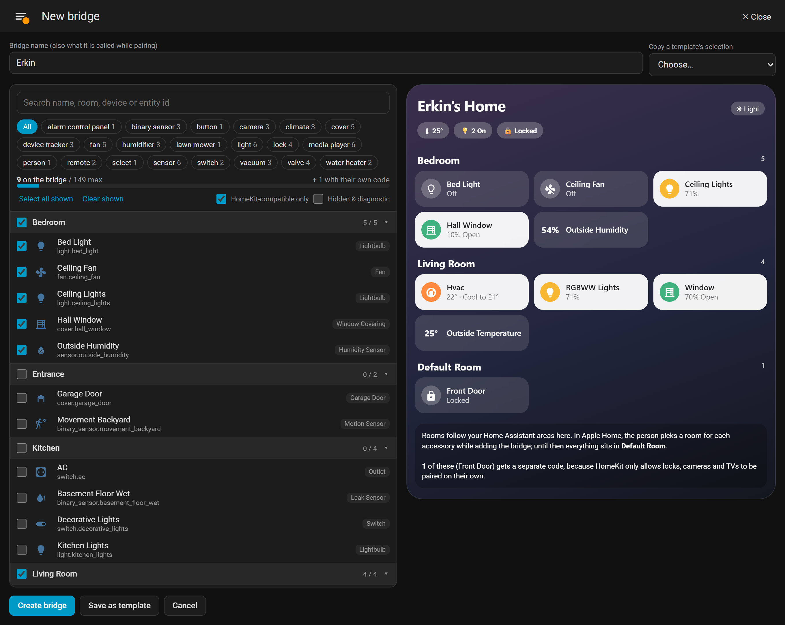
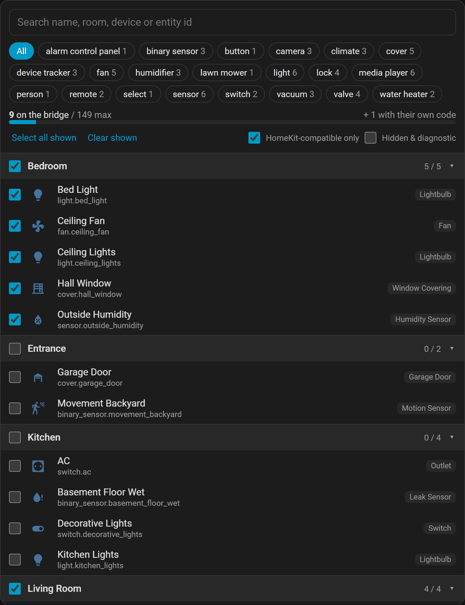
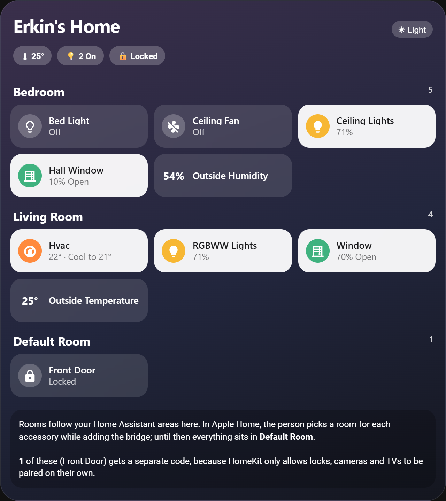
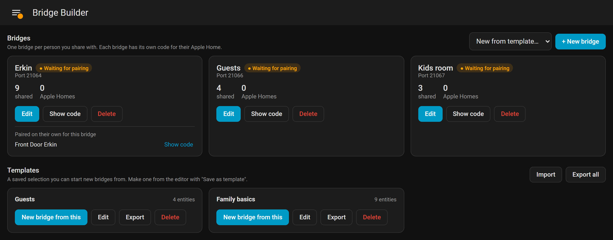

# Bridge Builder for HomeKit

The easy way to build and manage HomeKit bridges in Home Assistant: choose exactly what to share, see how it will look in Apple Home, and reuse your setups.

Bridge Builder adds a polished, easy-to-use page to your Home Assistant sidebar. Pick the entities to share, filter down to the ones Apple Home supports natively, check a live preview, and create the bridge.

## Why use it

Home Assistant's built-in HomeKit Bridge setup works, but it's tedious, especially with more than one bridge.

- **Hard to understand.** You work through domain rules and include or exclude lists, with no sign of what the result will look like in Apple Home.
- **Little visibility.** Once a bridge exists, seeing what it actually shares is too complicated. Here, you open the bridge and see it, in a preview.
- **Nothing to reuse.** Every new bridge starts from scratch. Here, you save a selection as a template, start new bridges from it, and export it to a file.

It's also useful without a home hub: Apple Home's *Invite People* needs one, so a separate bridge is how each person gets their own devices.

## Features

### Choose what to share

Every entity is grouped by room, with search, domain filters and "select the whole room". **HomeKit-compatible only** hides what Apple Home can't show, and hidden and diagnostic entities stay out of the way until you ask for them. Each row tells you what the entity becomes in Apple Home, such as Lightbulb, Outlet or Window Covering.

### See how it will look

A Home-app-style preview updates as you pick, with real states like "71%", "10% Open" and "Locked".

### A new bridge for each person, in one click

Select **Create bridge** to get a HomeKit bridge with exactly the entities you picked, plus its QR code and setup code. Rename or change it at any time.

### Templates

Save a selection like "Guests" or "Family basics" and start new bridges from it. Export templates to a file as a backup, or import them.

### Locks, cameras and TVs

HomeKit requires these to be paired on their own. Bridge Builder creates those separate pairings for you, links them to the bridge, and shows all the codes together.

### Normal HomeKit bridges

Everything it creates is a standard entry in Home Assistant's own HomeKit Bridge integration. If you remove Bridge Builder, the bridges keep working.

<!-- ha-marketplace:exclude-start -->
## Install

### Home Assistant 2026.11 or newer

Select the button and follow the steps in Home Assistant. Or add it by hand:

1. Go to **Settings → Marketplace → Add from link**. Home Assistant asks you to connect GitHub the first time.
2. For the GitHub link, enter `https://github.com/erkin-io/bridge-builder-homekit`. If asked for the type, choose **Integration**.
3. Select **Add**, then **Install**.
4. Setup opens without a restart. A **Bridge Builder** page then appears in the sidebar, for admins only.

### Home Assistant 2026.10

Select the button if you have HACS, or add this repository to HACS as a custom *Integration* repository, or copy `custom_components/homekit_bridge_builder` into `/config/custom_components/`. Restart Home Assistant, then go to **Settings → Devices & services → Add integration → Bridge Builder for HomeKit**.
<!-- ha-marketplace:exclude-end -->

## Use

1. Open **Bridge Builder** in the sidebar and select **New bridge**.
2. Name it after the person, pick their devices, and check the preview.
3. Select **Create bridge**, then send them the QR code or setup code.
4. On their iPhone: **Home app → + → Add Accessory**, then scan the code. They add it to their own Home.

## Limits

- Each bridge pairs with one Apple Home.
- Without a home hub, the person can only control devices while on your home network.
- A bridge holds at most 149 accessories.

## Things to know

- Saving an existing bridge switches its filter to an **exact list**. A bridge that used "all lights" rules no longer picks up new lights by itself.
- Removing an entity from a paired bridge removes it from that person's Apple Home, along with the scenes and automations there that use it. The editor warns before saving.
- Anyone holding a setup code can pair an unpaired bridge, so share codes only with the person they are for.
- You can rename a bridge in its editor, and it stays paired. Apple Home may keep showing the old name, and it can be renamed there. HomeKit names allow plain letters and numbers only, so `Ötüken` becomes `Otuken`.
- Rooms in the preview follow your Home Assistant areas. In Apple Home, the person picks rooms while adding the bridge.
- A device that isn't loaded when you save stays on its bridge, marked **Not loaded**. A *new* lock, camera or TV can't get its own pairing until it loads.
- Bridges made before Home Assistant started pairing locks and TVs separately keep them on the bridge. Bridge Builder leaves those as they are.
- Removing the integration deletes its saved templates, so export them first if you want to keep them. The bridges stay.
- A template file holds template names and entity IDs, which can reveal things like room and device names. Importing never overwrites a template: exact copies are skipped, and a different one with the same name gets a number. Entities the other Home Assistant doesn't have show as **Not loaded**.

Bridge Builder relies on some internals of Home Assistant's HomeKit integration, so a Home Assistant update can break it. Please [open an issue](https://github.com/erkin-io/bridge-builder-homekit/issues) if that happens.

## Privacy

Everything stays in your Home Assistant. Bridge Builder makes no outside network connections, has no telemetry and installs no extra packages. Its page and commands are admin-only.

## About this project

This is a new project, built with the help of [Claude](https://claude.com/claude-code), an AI coding assistant. Tested with Home Assistant 2026.10.4 and 2026.11.0.

Not affiliated with or endorsed by Apple Inc. or the Open Home Foundation. HomeKit and Apple Home are trademarks of Apple Inc.

## License

[MIT](LICENSE)
